# 2.1 简介

在第1章中，我们从理想开关的角度介绍了金属-氧化物-半导体（MOS）晶体管的工作方式。如第1.9节所述，芯片的性能和功耗取决于晶体管和导线的电流与电容。在本章中，我们将更详细地研究MOS晶体管的特性；第6章将讨论导线。

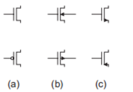

<small> 图 2.1 MOS晶体管符号</small>

图2.1显示了一些常用的MOS晶体管符号。图2.1(a)中的三端符号用于绝大多数原理图中。如果需要显示体（衬底或阱）连接，则使用图2.1(b)中的四端符号。图2.1(c)给出了文献中可能遇到的其他符号示例。

MOS晶体管是一种多数载流子器件，其中源极和漏极之间导电沟道中的电流由施加在栅极上的电压控制。在nMOS晶体管中，多数载流子是电子；在pMOS晶体管中，多数载流子是空穴。通过首先考察一个具有栅极和体但没有源极和漏极的孤立MOS结构，可以理解MOS晶体管的行为。图2.2显示了一个简单的MOS结构。该结构的顶层是称为栅极的良导体。早期晶体管使用金属栅极。晶体管栅极很快改用多晶硅，即由许多小晶体形成的硅，尽管在65nm及以下工艺中金属栅极正在复兴，如第3.4.1.3节所述。中间层是一层非常薄的SiO₂绝缘薄膜，称为栅氧化层。底层是掺杂的硅体。图中显示了p型体，其中的载流子是空穴。体接地，并在栅极上施加电压。栅氧化层是良好的绝缘体，因此从栅极到体几乎没有电流流过。

在图2.2(a)中，栅极上施加负电压，因此栅极带负电荷。带正电荷的可移动空穴被吸引到栅极下方的区域。这称为积累模式。在图2.2(b)中，栅极上施加一个较小的正电压，导致栅极带一些正电荷。体中的空穴被排斥出栅极正下方的区域，导致在栅极下方形成耗尽区。在图2.2(c)中，施加超过临界阈值电压Vt的更高正电压，将更多正电荷吸引到栅极。空穴被进一步排斥，体中的一些自由电子被吸引到栅极下方的区域。p型体中的这一导电电子层称为反型层。阈值电压取决于体中的掺杂剂数量和氧化层厚度tox。如本例所示，它通常为正，但也可以设计为负。

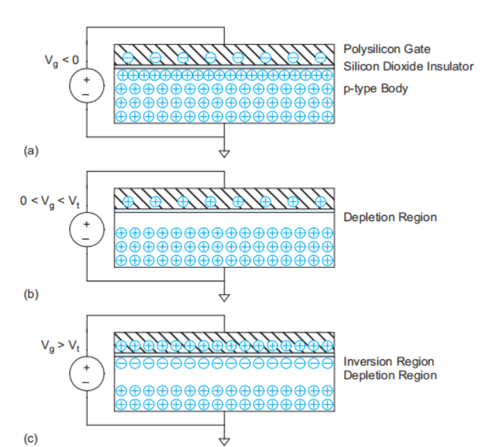

<small>图2.2 MOS结构演示（a）积累、（b）耗尽和（c）反型</small>

图2.3显示了一个nMOS晶体管。该晶体管由两个n型区域（称为源极和漏极）之间的MOS叠层构成。在图2.3(a)中，栅源电压Vgs低于阈值电压。源极和漏极具有自由电子，而体区具有自由空穴但无自由电子。假设源极接地，体区与源极或漏极之间的结为零偏或反偏，因此几乎没有电流流过。我们称该晶体管处于**截止**状态，这种工作模式称为**截止区**。通常将截止晶体管的电流近似为零是方便的，尤其是与导通晶体管的电流相比时。但请记住，流过截止晶体管的微小泄漏电流可能变得显著，尤其是当乘以芯片上数百万或数十亿个晶体管时。在图2.3(b)中，栅极电压高于阈值电压。此时，一个由电子（多数载流子）构成的**反型层**（称为**沟道**）连接了源极和漏极，形成导电通路并使晶体管**导通**。载流子数量和电导率随栅极电压增大而增加。漏源电压差为Vds = Vgs − Vgd。若Vds = 0（即Vgs = Vgd），则不存在推动电流从漏极流向源极的电场。

当在漏极施加一个小的正电位Vds时（图2.3(c)），电流Ids通过沟道从漏极流向源极。这种工作模式称为**线性区**、**电阻区**、**三极管区**、**非饱和区**或**不饱和区**；电流随漏极电压和栅极电压的增加而增加。如果Vds足够大，使得Vgd < Vt，则沟道在漏极附近不再反型，发生**夹断**（图2.3(d)）。然而，在正漏极电压的影响下，电子的漂移运动仍能引起传导。当电子到达沟道末端时，它们被注入漏极附近的耗尽区，并加速向漏极运动。超过该漏极电压后，电流Ids仅受栅极电压控制，不再受漏极影响。这种模式称为**饱和区**。

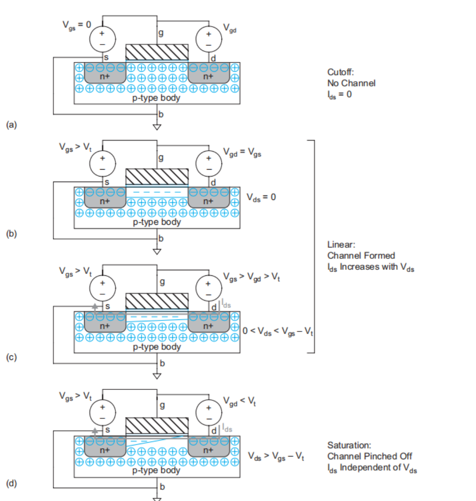

<small>图2.3 nMOS晶体管展示截止区、线性区和饱和区的工作状态</small>

总之，nMOS晶体管有三种工作模式。如果Vgs < Vt，晶体管截止（关闭）。如果Vgs > Vt，晶体管导通（开启）。如果Vds较小，晶体管表现为线性电阻，电流与Vds成正比。如果Vgs > Vt且Vds较大，晶体管表现为电流源，电流变得与Vds无关。

图2.4中的pMOS晶体管的工作方式恰好相反。n型体区接高电位，因此与p型源极和漏极形成的结通常处于反偏状态。当栅极也为高电位时，漏极和源极之间没有电流流过。当栅极电压降低一个阈值Vt时，空穴被吸引，在栅极正下方形成p型沟道，使电流能够在漏极和源极之间流动。两种类型晶体管的阈值电压不一定相等，因此我们使用Vtn和Vtp来区分nMOS和pMOS阈值。

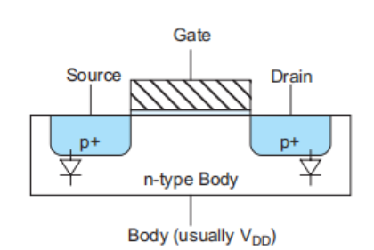

<small>图2.4 PMOS晶体管</small>

尽管MOS晶体管是对称的，但按照惯例，我们认为多数载流子从它们的源极流向漏极。由于电子带负电荷，nMOS晶体管的源极是两个端子中电位更负的那一端。空穴带正电荷，因此pMOS晶体管的源极是两个端子中电位更正的那一端。在静态CMOS门中，源极是更靠近电源轨的端子，而漏极是更靠近输出端的端子。

我们在第2.2节开始推导晶体管电流与电压（I-V）的理想模型。MOS电路的延迟由该电流对电路电容充放电所需的时间决定。第2.3节研究晶体管电容。MOS晶体管的栅极本质上是一个具有薄介质层的良好电容器；实际上，其电容负责吸引载流子到沟道，从而实现器件的工作。源极或漏极到体区的p-n结会产生额外的寄生电容。互连晶体管的导线电容也很重要，将在第6.2.2节中探讨。

这种理想的I-V模型提供了对晶体管行为的一般定性理解，但定量价值有限。一方面，它忽略了在短沟道长度L的晶体管中重要的太多效应。因此，该模型不足以精确计算电流。基于SPICE的电路仿真器使用BSIM等模型，这些模型相当全面地捕捉了晶体管行为，但需要整本书来完整描述。第8章讨论SPICE仿真。在这些仿真中出现的、对数字电路设计者影响最重要的效应将在第2.4节中讨论。另一方面，理想的I-V模型仍然过于复杂，无法用于估算大型电路性能的手算。因此，我们将在第4章中开发更简单的模型用于性能估算。

第2.5节通过应用I-V模型来理解CMOS门和传输晶体管的直流传输特性，以此总结本章。

# 2.2 长沟道电流-电压特性

如前所述，MOS晶体管具有三个工作区域：

- 截止区或亚阈值区
- 线性区
- 饱和区

让我们推导一个模型[Shockley52, Cobbold70, Sah64]，用于描述nMOS晶体管在上述每个区域中的电流与电压（I-V）关系。该模型假设沟道长度足够长，使得横向电场（源极和漏极之间的电场）相对较低，而在纳米级器件中情况已不再如此。该模型有多种称谓：长沟道模型、理想模型、一阶模型或肖克利模型。后续章节将对该模型进行修正，以反映高电场、泄漏和其他非理想效应。

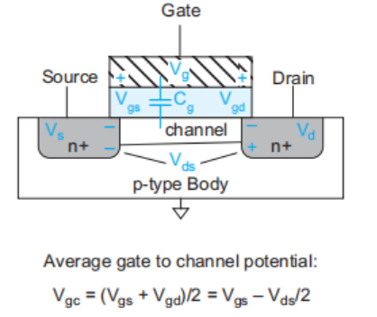

长沟道模型假设截止晶体管的电流为0。当晶体管导通（Vgs > Vt）时，栅极吸引载流子（电子）形成沟道。电子从源极向漏极漂移，其速率与这两个区域之间的电场成正比。因此，如果我们知道沟道中的电荷量及其移动速度，就可以计算电流。我们知道电容器每个极板上的电荷为Q = CV。因此，沟道中的电荷Qchannel为

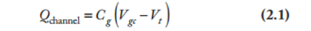

其中Cg是栅极到沟道的电容，Vgc − Vt是吸引电荷到沟道的电压中，超过从p型反型为n型所需最小电压的那部分。栅极电压是相对于沟道而言的，而沟道并未接地。如果源极电位为Vs，漏极电位为Vd，则平均电位为Vc = (Vs + Vd)/2 = Vs + Vds/2。因此，栅极与沟道电位之间的平均差值Vgc为Vg − Vc = Vgs − Vds/2，如图2.5所示。

我们可以将栅极建模为平行板电容器，其电容与面积除以厚度成正比。如果栅极长度为L、宽度为W，氧化层厚度为tox，如图2.6所示，则电容为

其中，ε₀ 是真空介电常数，为 8.85 × 10⁻¹⁴ F/cm，而 SiO₂ 的介电常数是它的 k₀ₓ = 3.9 倍。通常，ε₀ₓ/t₀ₓ 项称为 C₀ₓ，即栅氧化层的单位面积电容。

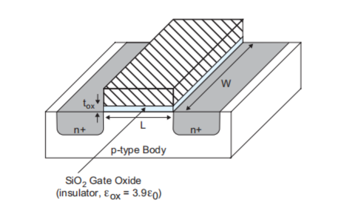

<small>图2.6 晶体管尺寸</small>

一些纳米工艺使用具有更高介电常数的不同栅极电介质。在这些工艺中，我们将tox称为等效氧化层厚度（EOT），即具有相同Cox的SiO₂层的厚度。在这种情况下，tox比实际电介质更薄。沟道中的每个载流子被加速到与横向电场（即源极和漏极之间的电场）成正比的平均速度v。比例常数μ称为迁移率。

迁移率的典型值为500–700 cm²/V·s。然而，当今大多数晶体管工作在场强远高于此的条件下，迁移率受到严重限制（见第2.4.1节）。

电场E等于漏极和源极之间的电压差Vds除以沟道长度L。

载流子穿过沟道所需的时间为沟道长度除以载流子速度：L/v。因此，源极和漏极之间的电流等于沟道中的总电荷量除以穿过所需的时间。

而

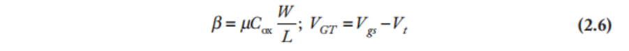

术语Vgs – Vt出现得如此频繁，因此将其缩写为VGT是方便的。
公式(2.5)描述了线性工作区，适用于Vgs > Vt但Vds相对较小的情况。之所以称为线性或电阻区，是因为当Vds << VGT时，Ids几乎随Vds线性增加，就像理想电阻一样。几何参数和工艺相关参数有时合并为一个因子β。不要将此处的β与双极晶体管中集电极电流与基极电流之比所用的符号相混淆。一些文献将工艺相关参数单独归为一个称为“k′”的常数。

如果Vds大于Vdsat（即VGT），沟道在漏极附近不再反型；我们说它被夹断了。超过这一点（称为漏极饱和电压），增加漏极电压对电流不再有进一步影响。将最大电流这一点上的Vds = Vdsat代入公式(2.5)，我们得到与Vds无关的饱和电流表达式。

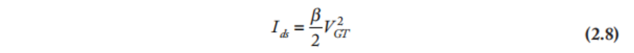

该表达式适用于Vgs > Vt且Vds > Vdsat的情况。因此，长沟道MOS晶体管在饱和区表现出平方律特性。晶体管的两个关键品质因数是Ion和Ioff。Ion（也称Idsat）是Vgs = Vds = VDD时的导通电流Ids。Ioff是Vgs = 0且Vds = VDD时的截止电流。根据长沟道模型，Ioff = 0，且

公式(2.10)总结了三个区域的电流：

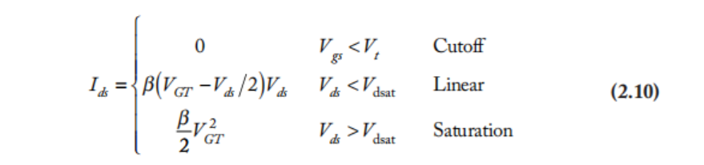

示例2.1  
考虑一个65 nm工艺中的nMOS晶体管，其最小绘制沟道长度为50 nm（λ = 25 nm）。设W/L = 4/2 λ（即0.1 μm / 0.05 μm）。在该工艺中，栅氧化层厚度为10.5 Å。估算70°C时电子的高场迁移率为80 cm²/V·s。阈值电压为0.3 V。使用长沟道模型绘制Vgs = 0、0.2、0.4、0.6、0.8和1.0 V时Ids随Vds变化的曲线。  
**解**：我们首先计算β。

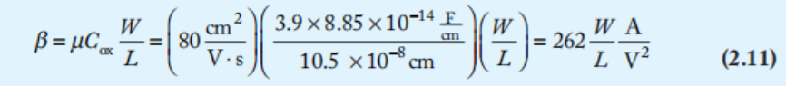

图2.7(a)显示了该晶体管的I-V特性。根据一阶模型，栅极电压低于Vt时电流为零。对于更高的栅极电压，在Vds较小时，电流随Vds线性增加。当Vds达到饱和点Vdsat = VGT时，电流趋于平稳，并最终在晶体管饱和时变得与Vds无关。我们随后将会看到，肖克利模型在高电压下高估了电流，因为它没有考虑高电场引起的迁移率退化和速度饱和。

pMOS晶体管的行为方式相同，但所有电压和电流的符号相反。其I-V特性位于第三象限，如图2.7(b)所示。为保持本文符号的简洁，我们将忽略符号，只需记住pMOS晶体管中电流从源极流向漏极即可。硅中空穴的迁移率通常低于电子。这意味着在相同尺寸下，pMOS晶体管提供的电流小于nMOS晶体管，因此速度较慢。符号μn和μp分别用于区分nMOS和pMOS晶体管中电子和空穴的迁移率。迁移率比μn/μp通常为2–3；本书示例中一般取2。pMOS晶体管与图2.7(a)中的nMOS具有相同的几何尺寸，但μp = 40 cm²/V·s，Vtp = –0.3 V。类似地，βn、βp、k′n和k′p有时也用于区分nMOS和pMOS的I-V特性。

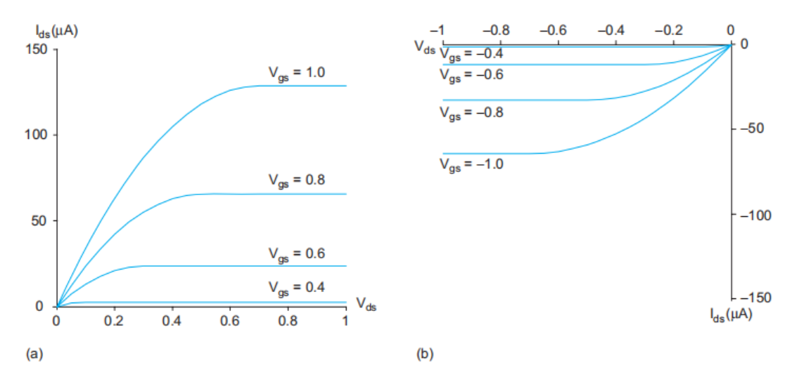

<small>图2.7 理想4/2 λ（a）nMOS和（b）pMOS晶体管的I-V特性</small>

# 2.3 C-V特性

MOS晶体管的每个端子与其他端子之间都存在电容。通常，这些电容是非线性的且与电压相关（即C-V特性）；然而，当它们的行为在逻辑门开关电压范围内取平均时，可以近似为简单电容。本节首先介绍适用于估算晶体管延迟和功耗的简单电容模型，然后探讨用于电路仿真的更详细模型。详细模型在初次阅读时可跳过。

## 2.3.1 简单MOS电容模型

MOS晶体管的栅极是一个良好的电容器。实际上，正是其电容吸引电荷使沟道反型，因此高栅极电容是获得高Ids所必需的。如第2.2节所述，栅极电容可以看作一个平行板电容器，栅极在上，沟道在下，中间是薄氧化层电介质。因此，电容为——

栅极电容的下极板是沟道，它不是晶体管的端子之一。当晶体管导通时，沟道从源极延伸（若晶体管处于非饱和区则到达漏极，若处于饱和区则提前截止）。因此，我们通常将栅极电容近似为终止于源极，并称之为Cgs。

逻辑电路中使用的大多数晶体管都采用最小可制造沟道长度，因为这样可以获得最高的速度和最低的动态功耗。因此，将这一最小长度L视为特定工艺的常数后，我们可以定义

当

值得注意的是，如果我们开发一种更先进的制造工艺，使得沟道长度和氧化层厚度按相同比例缩小，则每微米电容Cpermicron保持不变。这种关系对于快速计算很方便，但并不精确；在90nm和65nm节点，Cpermicron已从旧工艺中的约2 fF/µm下降到约1 fF/µm。表8.5列出了多种工艺下的栅极电容。

除了栅极之外，源极和漏极也存在电容。这些电容并非器件工作的根本，但会影响电路性能，因此被称为寄生电容。源极和漏极电容来自源/漏扩散区与体区之间的p-n结，因此也称为扩散电容Csb和Cdb。沿结形成无自由载流子的耗尽区，该耗尽区在导电的p型和n型区域之间起绝缘体作用，产生结电容。这些结电容的大小取决于源/漏扩散区的面积和周长、扩散深度、掺杂浓度以及电压。由于扩散区既有高电容又有高电阻，版图中通常使其尽可能小。经常见到三种类型的扩散区，如图2.8中两个串联晶体管所示。在图2.8(a)中，每个源极和漏极都有其各自独立的带接触孔的扩散区。在图2.8(b)中，底部晶体管的漏极和顶部晶体管的源极共用一个带接触孔的扩散区。在图2.8(c)中，源极和漏极合并为一个无接触孔的扩散区。当晶体管在VDD和GND之间开关时，每种类型区域的平均电容可以通过仿真计算或测量得到。表8.5也列出了多种工艺下每种情形的电容值。

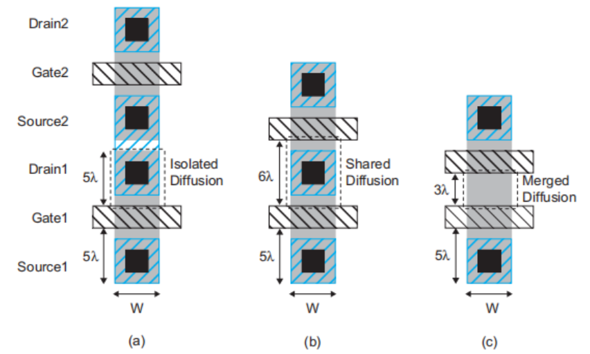

<small>图2.8 扩散区几何形状</small>

为了便于手算，您可以观察到，有接触孔的源区和漏区的扩散电容Csb和Cdb与栅极电容相当（例如，每微米栅极宽度为1–2 fF）。无接触孔的源/漏扩散电容略小，因为面积更小，但对于手算来说，这种差异通常不重要。在本书的示例中，将使用Cg = Csb = Cdb ≈ 1 fF/µm这一典型值，但您应使用第8.4节讨论的方法为您的工艺获取适当的数据。

## (选读)2.3.2 详细的MOS栅极电容模型

MOS栅极位于沟道上方，并可能部分覆盖源极和漏极扩散区。因此，栅极电容由两部分组成：本征电容Cgc（位于沟道上方）和交叠电容Cgol（与源极和漏极之间）。本征电容在公式(2.12)中被近似为简单平行板电容，其电容值为C₀ = WLCₒₓ。然而，电容的下极板取决于晶体管的工作模式。本征电容有三个分量，分别代表连接到底板的不同端子：Cgb（栅极到体）、Cgs（栅极到源极）和Cgd（栅极到漏极）。图2.9(a)绘制了在截止区和Vds较小时电容随Vgs的变化曲线，而图2.9(b)绘制了在线性区和饱和区电容随Vds的变化曲线[Dally98]。

1. **截止区**。当晶体管截止（Vgs < Vt）时，沟道未反型，栅极上的电荷与体区的相反电荷相匹配。这称为Cgb，即栅极到体电容。当Vgs为负时，晶体管处于积累区，Cgb = C₀。当Vgs增加但仍低于阈值时，表面形成耗尽区，这实际上将下极板从氧化层向下移动，从而减小电容，如图2.9(a)所示。
2. **线性区**。当Vgs > Vt时，沟道反型，再次充当良好的导电底板。然而，沟道连接到源极和漏极，而非体区，因此Cgb降至0。在Vds较小时，沟道电荷大致在源极和漏极之间均分，因此Cgs = Cgd = C₀/2。随着Vds增大，漏极附近区域反型程度降低，因此电容的更大比例归因于源极，更小比例归因于漏极，如图2.9(b)所示。
3. **饱和区**。当Vds > Vdsat时，晶体管饱和，沟道夹断。此时，所有本征电容都指向源极，如图2.9(b)所示。由于夹断效应，理想晶体管在饱和区的电容减小为Cgs = 2/3 C₀ [Gray01]。
4. 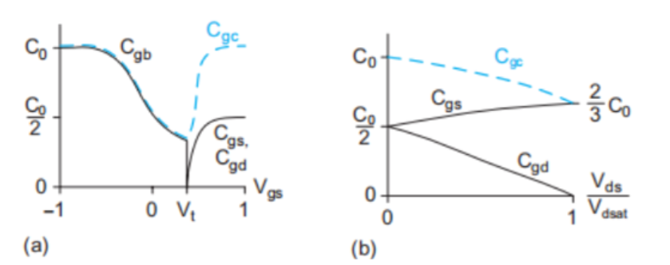

<small>图2.9 本征栅极电容 Cgc = Cgs + Cgd + Cgb 随 (a) Vgs 和 (b) Vds 变化的函数</small>

这三个区域中的行为可以近似为表2.1所示。

<small>表2.1 本征MOS栅极电容的近似</small>

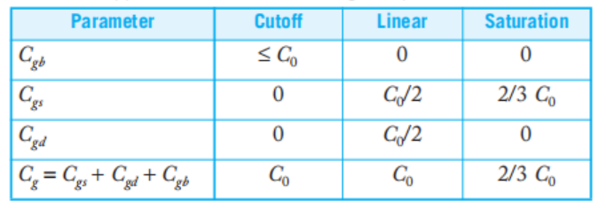

在实际器件中，栅极会与源极和漏极发生交叠，同时存在终止于源极和漏极的边缘电场。这会导致额外的交叠电容，如图2.10所示。这些电容与晶体管的宽度成正比。典型值为Cgsol = Cgdol = 0.2–0.4 fF/µm。它们应被加到本征栅极电容上，以得到总电容。

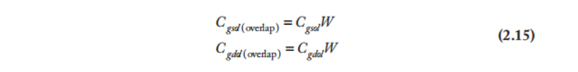

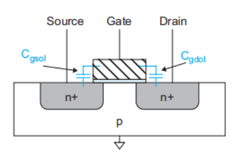

<small>图 2.10 **交叠电容**</small>

将栅极电容视为连接到栅极的单端电容（另一端不切换）是方便的。由于源极和漏极实际上构成第二端子，有效栅极电容随源极和漏极的开关活动而变化。图2.11显示了一个0.35μm工艺中，在七种不同源/漏行为组合下的有效栅极电容[Bailey98]。

通过使用基于电荷的模型可以实现更精确的栅极电容建模[Cheng99]。对于数字电路延迟计算的目的，我们通常将Cg近似为Cgs + Cgd + Cgb ≈ C₀ + 2CgolW，或使用从仿真中提取的有效电容[Nose00b]。重要的是要记住，该模型显著高估了刚好工作在阈值以下的晶体管的电容。

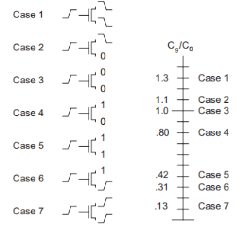

<small>**图2.11 与数据相关的栅极电容**</small>

## **(选读)2.3.3 详细的MOS扩散电容模型**

如第2.3.1节所述，源极扩散区与体区之间的p-n结在耗尽区上产生寄生电容。该电容取决于源极扩散区的面积AS和侧壁周长PS。几何结构如图2.12所示。面积为AS = W × D。周长为PS = 2W + 2D。在这段周长中，W与沟道相邻，其余的W + 2D则不相邻。

源极总寄生电容为

其中，Cjbs（体区与源极底部之间结的电容）的单位为电容/面积，Cjbssw（体区与源极侧壁之间结的电容）的单位为电容/长度。由于耗尽区厚度取决于偏置条件，这些寄生参数是非线性的。面积结电容项为[Gray01]：

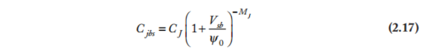

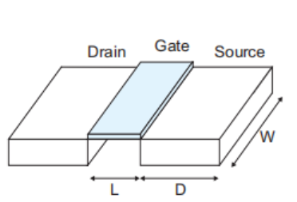

<small>图2.12 扩散区几何结构</small>

CJ是零偏置时的结电容，具有很强的工艺依赖性。MJ是结梯度系数，通常取值范围为0.5至0.33，具体取决于扩散结的陡峭程度。Φb是内建电势，取决于掺杂浓度。

vT是热力学中的热电压，不要与阈值电压Vt混淆。其值等于kT/q（室温下为26 mV），其中k = 1.380 × 10⁻²³ J/K是玻尔兹曼常数，T是绝对温度（室温下为300 K），q = 1.602 × 10⁻¹⁹ C是电子的电荷量。NA和ND分别是体区和源极扩散区的掺杂浓度。ni是本征硅中的本征载流子浓度，在300 K时其值为1.45 × 10¹⁰ cm⁻³。

侧壁电容项具有类似的形式，但使用不同的系数。

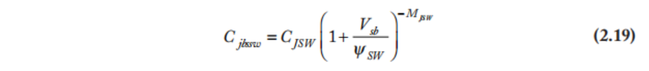

在约0.35μm以下的工艺中，采用浅槽隔离技术，用SiO₂绝缘体围绕晶体管（见第3.2.6节），沿非导电沟槽的侧壁电容往往极小，而面向沟道的侧壁电容则更为显著。在某些SPICE模型中，该侧壁（紧邻栅极和沟道）的电容由另一组参数指定：

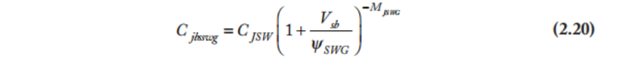

第8.3.4节将进一步讨论SPICE周长电容模型。

漏极扩散区具有类似的寄生电容，取决于AD、PD和Vdb。对于pMOS晶体管，也存在等效的关系，但掺杂浓度不同。由于电容是电压相关的，对数字设计者最有用的信息是开关转换期间的平均值。这就是第2.3.1节中给出的Csb或Cdb值。

示例2.2  
计算65 nm工艺中单位尺寸带接触孔的nMOS晶体管漏极的扩散寄生电容Cdb，条件为漏极电压分别为0 V和VDD = 1.0 V。假设衬底接地。扩散区符合图2.8中的设计规则，λ = 25 nm。晶体管特性参数为：CJ = 1.2 fF/µm²，MJ = 0.33，CJSW = 0.1 fF/µm，CJSWG = 0.36 fF/µm，MJSW = MJSWG = 0.10，以及室温下Φ₀ = 0.7 V。  

**解**：由图2.8可知，单位尺寸的扩散接触为4λ × 5λ，即0.1 µm × 0.125 µm。面积为0.0125 µm²，周长为0.35 µm，外加沿沟道方向的0.1 µm。在零偏置下，Cjbd = 1.2 fF/µm²，Cjbdsw = 0.1 fF/µm，Cjbdswg = 0.36 fF/µm。因此，总电容为

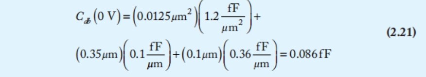

当漏极电压为VDD时，电容减小至

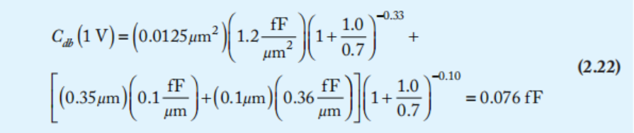

出于手算性能估算的目的，这种非线性电容过于繁琐。对于数字应用而言，在开关范围内取平均的有效电容就足够令人满意了。在本例中，有效漏极电容可以近似为两个极端值的平均值，即0.081 fF。

扩散区在历史上曾被用作短导线（称为“runner”），出现在仅有一两层金属的工艺中。由于扩散区的电容和电阻都很大，如今已不鼓励这种做法；在发生开关切换的节点上，扩散区应尽可能保持最小。

总而言之，MOS晶体管可视为一个四端器件，其每对端子之间都存在电容，如图2.13所示。栅极电容包括本征分量（指向体区、源极和漏极，或仅指向源极，具体取决于工作区域）以及与源极和漏极的交叠项。源极和漏极具有到体区的寄生扩散电容。

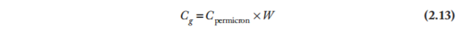

<small>图2.13 MOS晶体管的电容</small>

# 2.4 非理想I-V效应

公式(2.10)的长沟道I-V模型忽略了许多对沟道长度低于1微米的器件至关重要的效应。本节总结了对于设计者最重要的效应，然后对每种效应进行更深入的建模。

图2.14比较了65 nm工艺中1微米宽nMOS晶体管的仿真I-V特性与第2.2节中计算的理想特性。饱和电流随Vgs的增加而增加，但增速低于二次方关系。这由两种效应引起：速度饱和与迁移率退化。在高横向电场强度（Vds/L）下，载流子速度不再随电场强度线性增加。这称为速度饱和，导致在高Vds下Ids低于预期。在高垂直电场强度（Vgs/tox）下，载流子更频繁地受到氧化层界面的散射，从而减缓其运动。这种迁移率退化效应也导致在高Vgs下电流低于预期。非理想晶体管的饱和电流随Vds的增加而略有增加。这由沟道长度调制引起，其中较高的Vds增大了漏极周围耗尽区的尺寸，从而有效缩短了沟道。

阈值电压表示使沟道反型所需的栅极电压，主要由氧化层厚度和沟道掺杂浓度决定。然而，晶体管中的其他电场对沟道有一定影响，有效地改变了阈值电压。源极与体区之间电位的增加通过体效应提高阈值。漏极电压的增加通过漏致势垒降低降低阈值。沟道长度的增加通过短沟道效应提高阈值。

几种泄漏源导致标称截止的晶体管中有电流流过。当Vgs < Vt时，电流呈指数下降，而不是突然变为零。这称为亚阈值导电。流入栅极的电流Ig理想情况下为零。然而，随着栅氧化层厚度减少到仅有少数原子层时，电子隧穿通过栅极，导致一定的栅极泄漏电流。源极和漏极扩散区通常是反偏二极管，也会产生流入衬底或阱的结泄漏电流。

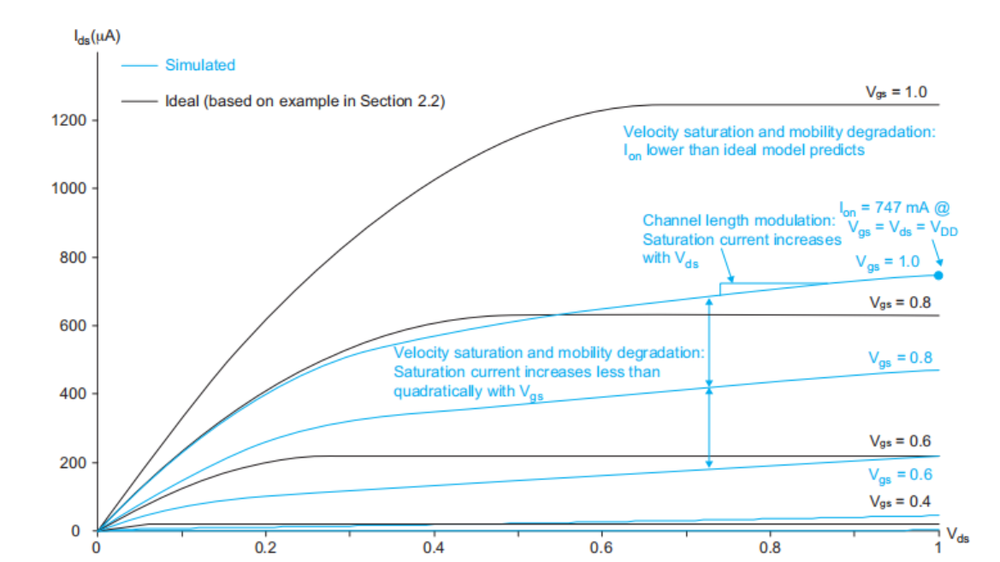

<small>图2.14 仿真和理想I-V特性</small>

迁移率和阈值电压都随温度升高而降低。对于强导通晶体管，迁移率效应通常占主导地位，导致高温下Ids降低。对于截止晶体管，阈值效应最为重要，导致高温下泄漏电流增大。总之，MOS特性随温度升高而退化。

定性理解非理想效应对于预测其对电路行为的影响，以及预期器件在未来工艺世代中的变化是有用的。然而，这些效应导致复杂的I-V特性，难以直接应用于手算。相反，这些效应被内置于良好的晶体管模型中，并通过SPICE或类似软件进行仿真。

## 2.4.1迁移率退化和速度饱和

回顾公式(2.3)，载流子漂移速度（从而电流）与源极和漏极之间的横向电场Elat = Vds/L成正比。比例常数称为载流子迁移率μ。长沟道模型假设载流子迁移率与外加电场无关。这在低场下是一个良好的近似，但当施加强横向或纵向电场时，该近似不再成立。

打个比方，想象您在VLSI实验室通宵工作后，决定跑过庭院去咖啡车。您已经熬了多少小时就像横向电场。熬夜越久，您想喝咖啡的欲望就越强烈：您的速度等于您的疲劳程度乘以您的迁移率。庭院中刮着大风，就像纵向电场。这风把您吹向墙壁，减缓了您的速度。同样地，晶体管栅极上的高电压会将载流子吸引到沟道边缘，导致与氧化层界面发生碰撞，从而减慢载流子的速度。这称为迁移率退化。此外，大一物理课刚下课，您偶尔会撞到一个困惑的大一新生，摔倒后不得不爬起来重新跑。这类似于载流子在硅晶格中的散射（技术上称为与光学声子的碰撞）。您跑得越快，碰撞就越频繁。超过某个疲劳程度后，您将达到一个最大平均速度。同样地，当施加高电场时，载流子会接近一个最大速度vsat。这种现象称为速度饱和。

迁移率退化可以通过将μ替换为一个更小的、随Vgs变化的有效迁移率μeff来建模。一个能够较好地匹配多个工艺实验数据的通用模型[Chen96, Chen97]为

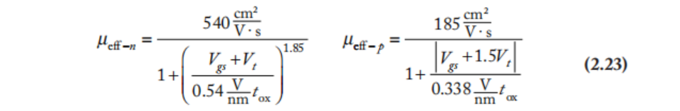

示例2.3  
计算nMOS和pMOS晶体管在完全导通时的有效迁移率。使用示例2.1中的物理参数。  
**解**：对于导通晶体管，取Vgs = 1.0 V，注意在pMOS晶体管中我们同样将电压视为正值。将Vt = 0.3 V和tox = 1.05 nm代入公式(2.23)可得：  
μeff-n(Vgs = 1.0) = 96 cm²/V·s，μeff-p(Vgs = 1.0) = 36 cm²/V·s。

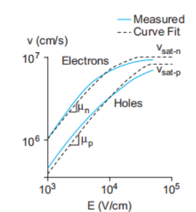

<small>图2.15 300 K下载流子速度随电场的变化，改编自[Jacoboni77]。速度在高场下趋于饱和。</small>

图2.15显示了载流子速度随漏极与源极之间电场E变化的实测数据。在低场下，速度随电场线性增加，斜率为迁移率μeff。当电场超过临界水平Ec时，速度趋于饱和，达到vsat，电子的vsat约为10⁷ cm/s，空穴约为8×10⁶ cm/s [Muller03]。如图所示，该速度可以用以下表达式进行相当好的近似[Toh88, Takeuchi94]：

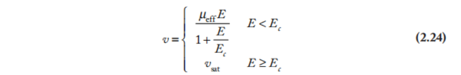

其中，由连续性条件，临界电场为

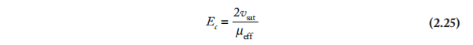

临界电压 Vc 是达到临界有效电场时的漏-源电压：Vc = EcL。

**示例 2.4**
使用示例2.3中的有效迁移率，求完全导通状态下nMOS和pMOS晶体管的临界电压。
**解**：使用公式(2.25)。

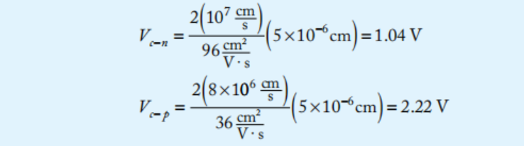

nMOS晶体管在正常工作条件下处于速度饱和状态，因为其临界电压Vc-n与VDD相当。pMOS晶体管的迁移率较低，因此速度饱和问题不那么严重。

使用与第2.2节类似的推导，结合公式(2.24)中新的载流子速度表达式，可以得到线性区和饱和区电流的修正方程[Sodini84]。

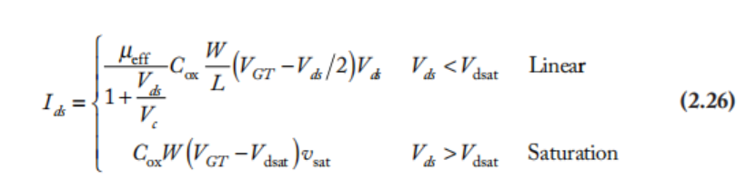

注意，由于迁移率退化，\( R_{\text{eff}} \) 是 \( V_{gs} \) 的递减函数。观察到线性区的电流与公式 (2.5) 相同，只是迁移率项被一个与 \( V_{ds} \) 相关的因子减小了。在足够高的横向电场下，电流饱和于某个取决于最大载流子速度的值。令公式 (2.26) 的两部分在 \( V_{ds} = V_{dsat} \) 处相等，我们可以求解饱和电压。

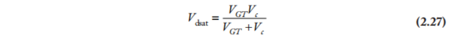

注意到公式(2.27)与并联电阻方程形式相同，可以看出Vdsat小于VGT和Vc中的较小者。最后，将公式(2.27)代入公式(2.26)，得到考虑速度饱和的简化饱和电流表达式：

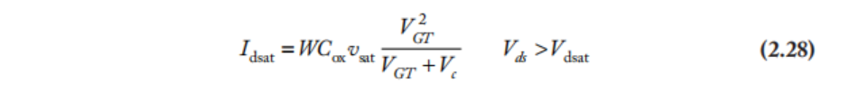

如果VGT远小于Vc，则速度饱和效应可忽略不计，公式(2.28)退化为平方律模型。这也称为长沟道区域。但如果VGT远大于Vc，则公式(2.28)趋近于速度饱和极限。

观察到，在长沟道区域，漏极电流与电压呈二次方关系；而在完全速度饱和时，则呈线性关系。在中等电源电压下，晶体管工作于速度既不随电场线性增加、也未完全饱和的区域。公式(2.30)给出的F次幂律模型提供了一个简单的近似来捕捉这一行为[Sakurai90]。F称为速度饱和指数，通过拟合实测I-V数据曲线确定。沟道较长或VDD较低的晶体管在饱和区呈现二次I-V特性，用F = 2建模。随着晶体管速度饱和程度加深，增大Vgs对电流的影响减小，F值降低，对于完全速度饱和的晶体管，F趋于1。为简化起见，该模型在线性区采用直线近似。总体而言，该模型基于三个参数，这些参数可通过I-V特性曲线的经验拟合确定：F、G Pc 和 Pv。

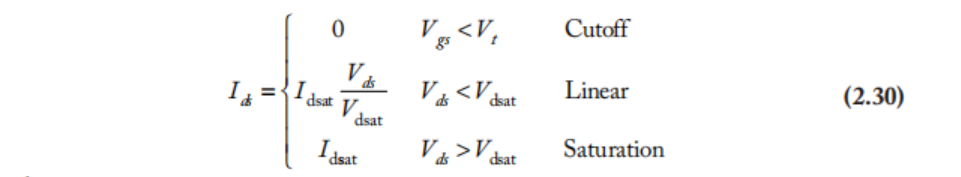

而

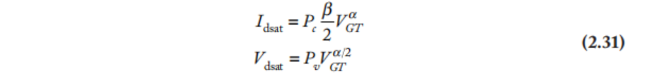

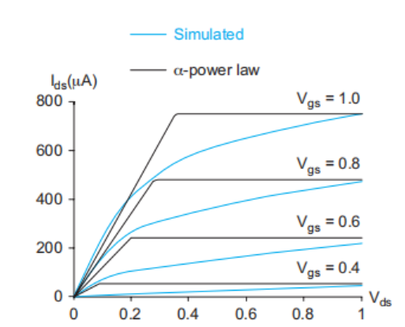

<small>图2.16 F次幂律模型与仿真晶体管行为的比较</small>

图2.16将F次幂律模型与仿真结果进行了比较，其中F = 1.3。在Vds较小时拟合效果较差，但在Vds = VDD时，电流在整个Vgs范围内与仿真结果相当吻合。

空穴的低场迁移率远低于电子，因此在给定的VDD下，pMOS晶体管比nMOS晶体管经历的速度饱和程度更轻。这表现为pMOS的F值大于nMOS。

这些模型对于手算来说过于复杂，难以提供太多直观认识。一种更简单的方法是观察到，在速度饱和晶体管中，当晶体管强导通时，Ids随Vgs线性增长而非二次方增长。图2.17绘制了Ids随Vgs变化的曲线（保持Vds = Vgs）。这等效于绘制Ion随VDD变化的曲线。当Vgs显著高于Vt时，Ids与直线的拟合相当好。因此，我们可以将导通电流近似为

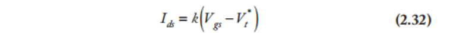

其中 Vt* 是 x 截距。

## 2.4.2 沟道长度调制

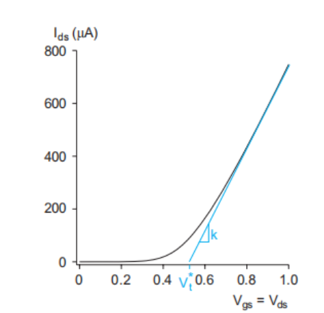

<small>图2.17 饱和区中Ids随Vgs的变化，显示高Vgs下良好的线性拟合</small>

理想情况下，处于饱和区的晶体管，其Ids与Vds无关，使得晶体管成为完美的电流源。如第2.3.3节所述，漏极与体区之间的p-n结形成一个耗尽区，其宽度Ld随Vdb的增加而增大，如图2.18所示。该耗尽区有效地将沟道长度缩短为

为了避免将体电压引入计算，我们假设源极电压接近体电压，因此Vdb ≈ Vds。因此，增大Vds会减小有效沟道长度。更短的沟道长度导致更高的电流；因此，在饱和区Ids随Vds增大而增大，如图2.18所示。这可以通过将公式(2.10)乘以因子(1 + Vds/VA)来粗略建模，其中VA称为厄利电压[Gray01]。在饱和区，我们得到

随着沟道长度变短，沟道长度调制效应变得相对更为重要。因此，VA与沟道长度成正比。这种沟道长度调制模型是对非线性行为的严重过度简化，对于概念理解比对于精确器件建模更有用。沟道长度调制对于模拟设计人员非常重要，因为它会降低放大器的增益。对于定性理解数字电路的行为，它通常不重要。

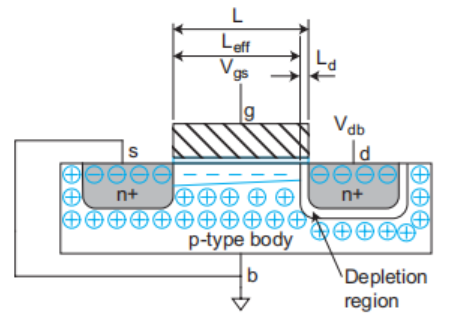

<small>图2.18 耗尽区缩短有效沟道长度</small>

## 2.4.3 阈值电压效应

到目前为止，我们都将阈值电压视为常数。然而，Vt随源极电压升高而增大，随体电压降低而减小，随漏极电压降低而减小，并随沟道长度增大而增大[Roy03]。本节对上述效应逐一建模。

2.4.3.1 体效应 到目前为止，我们一直将晶体管视为具有栅极、源极和漏极的三端器件。然而，体区是隐含的第四端。当在源极与体区之间施加电压Vsb时，会使沟道反型所需的电荷量增加，因此会提高阈值电压。阈值电压可建模为

其中Vt₀是源极处于体电位时的阈值电压，Ks是阈值时的表面势（有关表面势的进一步讨论，参见器件物理教材如[Tsividis99]），γ是体效应系数，通常在0.4至1 V¹/²范围内。这些参数又取决于沟道中的掺杂浓度NA。体效应会进一步降低传输晶体管尝试传递弱值（例如nMOS晶体管传递‘1’）时的性能，我们将在第2.5.4节中讨论。第5.3.4节将描述如何有意施加体偏置来改变阈值电压，从而在性能与亚阈值泄漏电流之间进行权衡。

对于施加在源极或体区上的小电压，公式(2.35)可以线性化为

其中

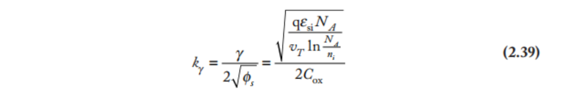

示例2.5  
考虑一个65 nm工艺中的nMOS晶体管，其标称阈值电压为0.3 V，掺杂浓度为8 × 10¹⁷ cm⁻³。体区通过衬底接触接地。在室温下，如果源极电压为0.6 V而非0 V，阈值变化多少？  
**解**：在室温下，热电压vT = kT/q = 26 mV，且ni = 1.45 × 10¹⁰ cm⁻³。阈值增加0.04 V。

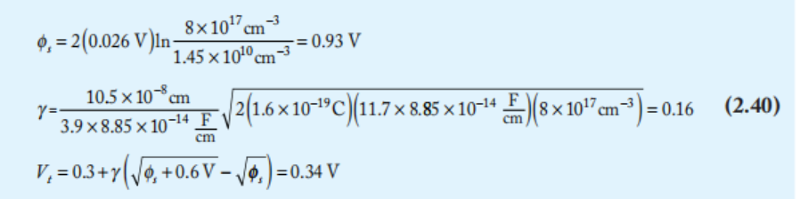

2.4.3.2 漏致势垒降低  
漏极电压Vds产生的电场会影响阈值电压。这种漏致势垒降低（DIBL）效应在短沟道晶体管中尤为显著。它可以建模为——

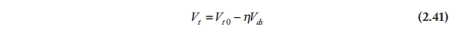

2.4.3.3 短沟道效应  
阈值电压通常随沟道长度增加而增大。这种现象在L较小、源极和漏极耗尽区延伸到沟道相当大一部分时尤为显著，因此被称为短沟道效应或Vt滚降[Tsividis99, Cheng99]。在某些工艺中，反向短沟道效应会导致Vt随长度增加而减小。  

此外还存在窄沟道效应，即Vt随沟道宽度变化；由于最小宽度通常大于最小长度，该效应往往不那么显著。

## 2.4.4 泄漏

即使晶体管在标称上处于截止状态，它们也会泄漏少量电流。泄漏机制包括源极与漏极之间的亚阈值导电、栅极到体的栅极泄漏，以及源极到体和漏极到体的结泄漏，如图2.19所示[Roy03, Narendra06]。亚阈值导电由载流子热发射越过阈值所设定的势垒引起。栅极泄漏是由隧穿穿过极薄栅极电介质的量子力学效应引起的。结泄漏是由流过源/漏扩散区与体区之间p-n结的电流引起的。

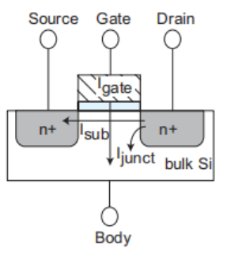

<small>图2.19 泄漏电流路径</small>

在特征尺寸大于180nm的工艺中，泄漏通常不显著，除非在极低功耗应用中。在90nm和65nm工艺中，阈值电压已降低到亚阈值泄漏达到每个晶体管数纳安至数十纳安的水平，当乘以芯片上数百万或数十亿个晶体管时，这一数值变得相当可观。在45nm工艺中，氧化层厚度减薄到使栅极泄漏变得与亚阈值泄漏相当的程度，除非采用高k栅极电介质。总体而言，泄漏已成为纳米工艺中重要的设计考量因素。

2.4.4.1 亚阈值泄漏  
长沟道晶体管I-V模型假设仅当Vgs > Vt时才有电流从源极流向漏极。在实际晶体管中，电流在阈值以下并不会突然截止，而是呈指数下降，如图2.20所示。当栅极电压较高时，晶体管处于强导通状态。当栅极电压降至Vt以下时，电流的指数下降在对数坐标上表现为一条直线。Vgs < Vt的这一区域称为弱反型区。由于漏致势垒降低（见第2.4.3.2节），亚阈值泄漏电流随Vds显著增大。Ids存在一个下限，由漏极结泄漏设定，且该下限在负栅极电压下会进一步恶化（见第2.4.4.3节）。

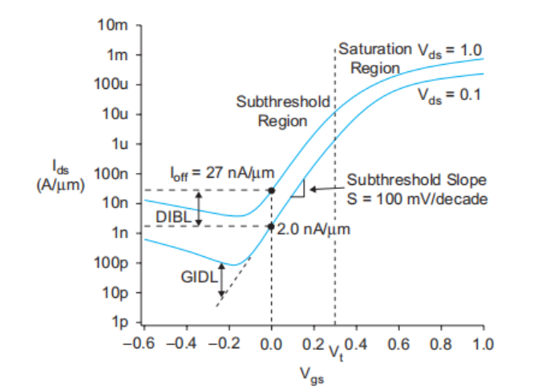

<small>图2.20 65 nm nMOS晶体管在70°C时对数坐标下的I-V特性</small>

亚阈值泄漏电流由公式(2.42)描述。Ids0是阈值处的电流，取决于工艺和器件几何尺寸，通常从仿真中提取，但也可由公式(2.43)计算得出；其中e^1.8项是根据经验得出的[Sheu87]。n是与耗尽区特性相关的工艺相关参数，对于CMOS工艺，其典型范围为1.3至1.7。最后一项表明，如果Vds = 0，泄漏为0，但当Vds为热电压vT的几倍时（例如Vds > 50 mV时），泄漏增加到其全部值。更重要的是，漏致势垒降低（如MVds项所示）实际上降低了阈值电压，这可能导致Vds = VDD时的泄漏比小Vds时增加一个数量级。当Vsb ≈ 0时，体效应也会调制Vt。

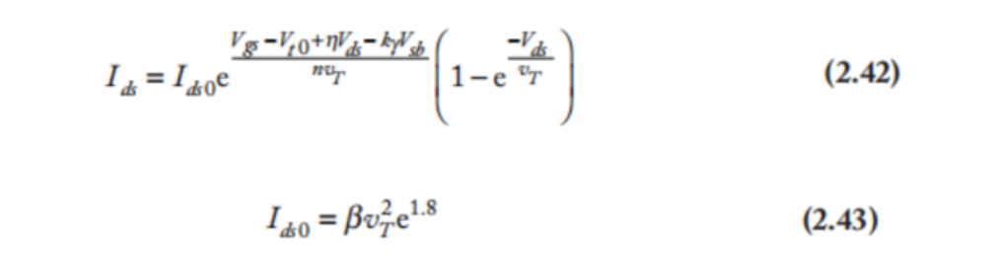

亚阈值导电在极低功耗电路中被加以利用，这将在第9.6节中探讨。它会影响依赖于电容器上电荷存储的动态电路和DRAM。通过截止晶体管的导电会使电容器放电，除非定期刷新或有少量电流来抵消泄漏。泄漏也会导致空闲电路中的功耗。亚阈值泄漏随Vt降低或温度升高呈指数增长，因此对于使用低电源电压和阈值电压的芯片以及工作在高温下的芯片来说，这是一个主要问题。

如图2.20所示，亚阈值电流在半对数图上拟合为一条直线。该直线斜率的倒数称为亚阈值斜率S。

亚阈值斜率表示栅极电压必须降低多少才能使泄漏电流减小一个数量级。室温下的典型值为100 mV/十倍频程。公式(2.42)可以使用亚阈值斜率重写为

其中 \( I_{\text{off}} \) 是 \( V_{gs} = 0 \)、\( V_{ds} = V_{DD} \) 时的亚阈值电流。

示例2.6  
在室温下，若n = 1.5，对于截止晶体管（Vgs = 0），其泄漏电流至少要比勉强导通（Vgs = Vt）的晶体管小10³倍，所需的最小阈值电压是多少？绝缘体上硅（SOI）工艺的一个优点是具有更小的n（见第9.5节）。若n = 1.3，SOI所需的阈值电压是多少？  
**解**：室温下vT = 26 mV。假设Vds远大于vT，因此泄漏显著。求解

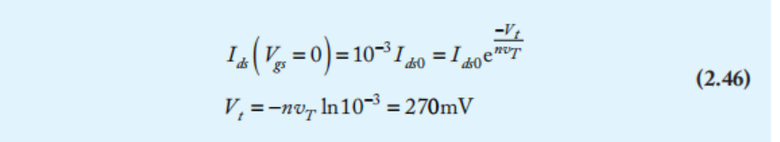

在CMOS工艺中，Vgs每低于阈值90 mV，泄漏电流就下降一个数量级。这通常被称为亚阈值斜率S = 90 mV/十倍频程。在SOI工艺中，亚阈值斜率S为78 mV/十倍频程，因此仅需234 mV的阈值电压。

2.4.4.2 栅极泄漏  
根据量子力学，原子周围的电子云具有概率性的空间分布。对于厚度小于15–20 Å的栅氧化层，栅极中的电子有一定概率出现在氧化层的另一侧，从而被沟道迅速带走。载流子穿过薄势垒的效应称为隧穿，并导致通过栅极的泄漏电流。

栅极隧穿的两种物理机制分别为福勒-诺德海姆（FN）隧穿和直接隧穿。FN隧穿在高电压和中等氧化层厚度下最为重要，并用于编程EEPROM存储器（见第12.4节）。直接隧穿在低电压和薄氧化层下最为重要，是主要的泄漏成分。

直接栅极隧穿电流可估计为[Chandrakasan01]：

公式(2.48)中，A和B为工艺相关常数。
晶体管需要较高的Cox以获得良好的导通电流，这推动了氧化层厚度的减薄。隧穿电流随氧化层厚度呈指数下降，只是近来才变得显著。图2.21绘制了不同氧化层厚度下栅极泄漏电流密度（电流/面积）JG随电压的变化曲线。厚度每减少1 Å，栅极泄漏增加约2.7倍或更多[Rohrer05]。较大的隧穿电流不仅影响动态节点，也影响静态功耗，因此将等效氧化层厚度tox限制在至少10.5 Å，以使栅极泄漏低于100 A/cm²。从尺寸角度来看，每层SiO₂原子层约为3 Å，因此这种栅氧化层仅有数个原子层的厚度。第3.4.1.3节将介绍具有更高介电常数的栅极绝缘体创新技术，这些技术在减少隧穿的同时提供良好的Cox。

对于采用SiO₂栅极电介质的晶体管，nMOS的隧穿电流可能比pMOS高一个数量级，因为电子从导带隧穿，而空穴从价带隧穿，面临更高的势垒[Hamzaoglu02]。不同电介质可能具有不同的隧穿特性。

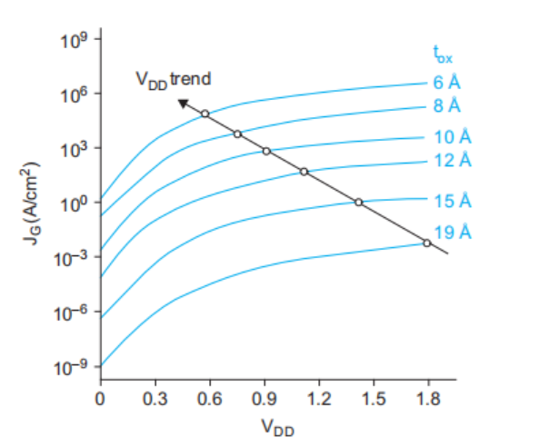

<small>图2.21 栅极泄漏电流（来自[Song01]）</small>

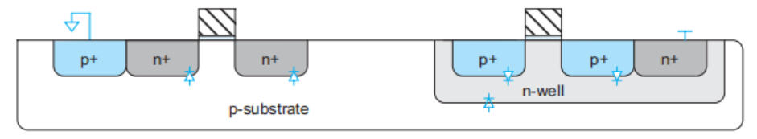

<small>图2.22 CMOS电路中的衬底-扩散区二极管</small>

2.4.4.3 结泄漏  
扩散区与衬底或阱之间的p-n结形成二极管，如图2.22所示。阱-衬底结是另一个二极管。衬底和阱分别连接到GND或VDD，以确保这些二极管在正常工作时不会正偏。然而，反偏二极管仍会传导少量电流ID。

其中IS取决于掺杂浓度以及扩散区的面积和周长，VD为二极管电压（例如 –Vsb 或 –Vdb）。当结的反偏电压显著大于热电压时，泄漏电流仅为 –IS，通常在 0.1–0.01 fA/µm² 范围内，与其他泄漏机制相比可忽略不计。

更重要的是，重掺杂漏区容易发生**带间隧穿（BTBT）** 和**栅致漏极泄漏（GIDL）**。

BTBT 发生在源/漏区与体区之间的结上，当该结反偏时产生。它取决于反偏电压和掺杂浓度。用于提高 Vt 以减轻亚阈值泄漏的高浓度晕环掺杂，反而导致 BTBT 增大。当硅晶格中的缺陷（称为陷阱）缩短了载流子必须隧穿的距离时，陷阱辅助隧穿（TAT）会进一步加剧泄漏。大部分泄漏发生在最靠近沟道的侧壁，此处掺杂浓度最高。它可以建模为

其中 \(X_j\) 是扩散区的结深，\(E_g\) 是带隙电压，而 \(A\) 和 \(B\) 是工艺相关常数 [Mukhopadhyay05]。在反偏电压为 \(V_{DD}\) 时，沿结的电场为

GIDL发生在栅极部分重叠漏极的区域。当漏极处于高电压而栅极处于低电压时，这种效应最为显著。GIDL电流与栅-漏交叠面积成正比，因此与晶体管宽度成正比。它是电场的强函数，因此随漏-栅电压的增加而迅速增大。然而，在 |Vgd| ≤ VDD 时它通常不显著，仅在试图通过将栅极驱动到电源轨以外来切断亚阈值泄漏时才起作用。

## 2.4.5 温度依赖性

晶体管特性受温度影响[Cobbold66, Vadasz66, Tsividis99, Gutierrez01]。载流子迁移率随温度升高而降低。近似关系为

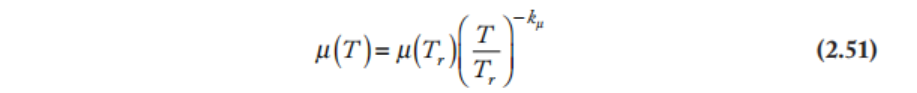

阈值电压的大小随温度升高几乎线性下降，可近似为：

其中 \( k_{vt} \) 通常约为 1–2 mV/K。  
在高 VDD 下，\( I_{on} \) 随温度升高而降低。亚阈值泄漏随温度呈指数增加。BTBT 随温度缓慢增加，而栅极泄漏几乎与温度无关。  

综合温度效应如图 2.23 所示。在高 Vgs 下，电流具有负温度系数，即随温度升高而降低。在低 Vgs 下，电流具有正温度系数。因此，截止电流随温度升高而增加。  
导通电流 \( I_{dsat} \) 通常随温度升高而降低，如图 2.24 所示，因此电路性能在高温下最差。然而，对于工作在低 VDD（通常 < 0.7–1.1 V）下的系统，\( I_{dsat} \) 随温度升高而增加 [Kumar06]。

<small>图2.23 不同温度下处于饱和区的nMOS晶体管的I-V特性</small>                     <small>图2.24 Idsat随温度变化</small>

相反，电路性能可以通过冷却来提高。大多数系统使用自然对流或风扇配合散热器，但如果成本合理，水冷、薄膜制冷甚至液氮也能提高性能。低温工作有很多优点[Keyes70, Sun87]。亚阈值泄漏随温度呈指数依赖，因此可以使用较低的阈值电压。速度饱和发生在更高的电场下，从而提供更大的电流。由于迁移率也更高，这些电场在较低的电源电压下即可达到，从而节省功耗。耗尽区变宽，导致结电容减小。

确定电路中温度依赖性的两种常用实验室工具是冷冻喷雾和热风枪。前者可用于短暂“冻结”芯片以观察性能是否变化，而后者当然可用于加热芯片。通常，这些测试用于快速判断芯片是否容易受到温度影响。请小心——有时温度突然变化可能会使芯片或封装破裂。

## 2.4.6 几何依赖性

版图设计者绘制的晶体管具有宽度和长度 \( W_{\text{drawn}} \) 和 \( L_{\text{drawn}} \)。实际栅极尺寸可能与某些因子 \( X_W \) 和 \( X_L \) 存在偏差。例如，制造商可能在保持整体设计规则或金属间距不变的情况下，制作更窄的多晶硅掩模版，或对多晶硅进行过刻蚀以获得更短的沟道（负的 \( X_L \)）。此外，源极和漏极会在栅极下方横向扩散 \( L_D \)，产生载流子必须在源极和漏极之间穿行的较短有效沟道长度。类似地，\( W_D \) 考虑了其他缩小晶体管宽度的效应。综合这些因素，我们可以计算出有效的晶体管长度和宽度，以替代本书其他部分电流和电容方程中的 \( L \) 和 \( W \)。系数2来源于沟道两侧的横向扩散。

因此，绘制长度为两倍的晶体管，其有效长度可能超过两倍。类似地，两个绘制宽度相差两倍的晶体管，其饱和电流的差异可能超过两倍。由于短沟道效应和窄沟道效应，阈值电压也会随晶体管尺寸变化。

综合考虑阈值变化、有效沟道长度、沟道长度调制和速度饱和效应，Idsat并不精确地按1/L缩放。一般而言，当需要精确匹配电流时（例如在灵敏放大器或A/D转换器中），最好对每个器件使用相同的宽度和长度。电流比可以通过并联多个相同的晶体管来实现。

在0.25μm以下的工艺中，晶体管的有效长度还显著取决于晶体管的取向。此外，附近多晶硅的数量也会影响制造过程中的刻蚀速率，从而影响沟道长度。需要良好匹配的晶体管应具有相同的取向。可在附近放置虚拟多晶硅导线以改善刻蚀均匀性。

## 2.4.7 总结

尽管纳米级器件的物理特性十分复杂，但从设计者的角度来看，非理想I-V行为的影响相当容易理解。

**阈值损失**：传输晶体管在传递错误逻辑值时会发生阈值损失：nMOS晶体管只能上拉至VDD – Vtn，而pMOS晶体管只能下拉至|Vtp|。体效应会加剧阈值损失的幅度。因此，在阈值电压占电源电压较大比例的纳米工艺中，传输晶体管工作效果不佳。在需要同时良好传递0和1的场合，应使用全互补传输门。

**泄漏电流**：理想情况下，静态CMOS门在空闲时电流为零且不消耗功率。实际的门会存在一定的泄漏电流。目前最重要的来源是应处于截止状态的晶体管源极与漏极之间的亚阈值泄漏。截止晶体管的亚阈值电流，其Vgs每低于Vt 60–100 mV，电流便下降一个数量级。阈值电压持续降低，因此亚阈值泄漏急剧增加。某些工艺提供多种Vt选择：低Vt器件用于关键电路的高性能，高Vt器件用于其他部分的低泄漏。

晶体管的栅极是良好的绝缘体。然而，在极薄的栅极上会有显著的隧穿电流流过。这限制了栅氧化层的缩小，并促使采用新型高k栅极电介质。

泄漏电流导致CMOS门在空闲时消耗功率。它还限制了动态逻辑、锁存器和存储单元中数据保持的时间。在纳米工艺中，动态逻辑和锁存器需要某种反馈以防止数据因泄漏而丢失。泄漏在高温下会增大。

**VDD**：速度饱和与迁移率退化导致高电压下的电流低于预期。这意味着试图使用高VDD来获得快速晶体管是没有意义的，因此VDD已随工艺代次不断降低以减小功耗。此外，过短的沟道和过薄的栅氧化层会被高VDD损坏。

**延迟**：串联晶体管会分担部分电压降，因此每个晶体管所受电场较小，速度饱和程度也比单个晶体管轻。因此，串联晶体管的实际速度比简单模型预测的略快。例如，两个串联的nMOS晶体管提供的电流大于单个同宽nMOS晶体管电流的一半。这种效应在nMOS晶体管中比pMOS晶体管更明显，因为nMOS晶体管原本迁移率更高，因而速度饱和更严重。

**匹配**：如果两个晶体管应具有相同行为，则两者应具有相同的尺寸和取向，且如有可能应采用叉指布局。

# 2.5 直流传输特性

数字电路仅仅是使用在其特定范围内工作的模拟电路。电路的直流传输特性描述了输出电压与输入电压之间的关系，其假设输入变化足够缓慢，使得电容有充足的时间充电或放电。特定的输入和输出电压范围被定义为有效的0和1逻辑电平。本节探讨CMOS门和传输晶体管的直流传输特性。

## 2.5.1 静态CMOS反相器直流特性

让我们推导静态CMOS反相器（如图2.25所示）的直流传输函数（Vout随Vin变化）。我们从表2.2开始，该表概述了n晶体管和p晶体管的各种工作区域。在该表中，Vtn是n沟道器件的阈值电压，Vtp是p沟道器件的阈值电压。注意Vtp为负值。公式分别用Vgs/Vds和Vin/Vout给出。由于nMOS晶体管的源极接地，因此Vgsn = Vin且Vdsn = Vout。由于pMOS晶体管的源极接VDD，因此Vgsp = Vin – VDD且Vdsp = Vout – VDD。

<small>图 2.25 一个CMOS反相器</small>

表2.2 CMOS反相器三个工作区域的电压关系

目标是找到输出电压（Vout）随输入电压（Vin）变化的函数。这可以通过图解方式、解析方式（见习题2.16）或通过仿真来获得[Carr72]。给定Vin，我们必须在约束条件Idsn = |Idsp|下找到Vout。为简化起见，我们假设Vtp = –Vtn，且pMOS晶体管的宽度是nMOS晶体管的2–3倍，使得βn = βp。我们将在第2.5.2节中放宽这一假设。

我们首先对两个晶体管（如图2.26(a)所示）用公式(2.10)描述的简单代数方程进行图形表示。该图显示了对于不同的Vgsn和Vgsp值，Idsn和Idsp随Vdsn和Vdsp变化的曲线。图2.26(b)将相同的Idsn和|Idsp|曲线重新绘制为对于不同Vin值下随Vout变化的曲线。反相器的可能工作点（用点标记）是在给定Vin下Idsn = |Idsp|时的Vout值。这些工作点在图2.26(c)的Vout对Vin坐标轴上绘出，以显示反相器的直流传输特性。电源电流IDD = Idsn = |Idsp|也在图2.26(d)中随Vin绘出，显示当Vin通过GND和VDD之间的电压时，两个晶体管瞬时导通，导致从电源抽取一个电流脉冲。

CMOS反相器的工作可以分为五个区域，如图2.26(c)所示。每个区域中每个晶体管的状态如表2.3所示。在区域A中，nMOS晶体管截止，因此pMOS晶体管将输出上拉至VDD。在区域B中，nMOS晶体管开始导通，将输出下拉。在区域C中，两个晶体管均处于饱和区。注意，理想晶体管仅在Vin = VDD/2时处于区域C，并且在此示例中，该区域传输曲线的斜率为 –∞，对应于无限增益。实际晶体管由于第2.4.2节所述的沟道长度调制而具有有限的输出电阻，因此在更宽的区域C内具有有限斜率。在区域D中，pMOS晶体管部分导通，在区域E中，pMOS晶体管完全截止，由nMOS晶体管将输出下拉至GND。还需注意，当输入电压在VDD或GND电源轨的一个阈值电压范围内时，理想情况下反相器的电流消耗为零（忽略泄漏）。这一特性对于低功耗工作非常重要。

<small>图2.26 CMOS反相器直流特性的图形推导</small>

**表2.3 CMOS反相器工作状态总结**

图2.27显示了65nm工艺中反相器的仿真结果。pMOS晶体管的宽度是nMOS晶体管的两倍，以实现近似相等的β值。仿真结果与简单模型相当吻合，尽管转换并非那么陡峭，因为晶体管在饱和区并非理想的电流源。

交越点 \( V_{inv} = V_{in} = V_{out} \) 称为输入阈值。由于nMOS和pMOS晶体管的迁移率及阈值电压的大小均随温度降低而下降，该门电路的输入阈值对温度仅微弱敏感。

<small>图2.27 仿真CMOS反相器直流特性</small>

## **2.5.2 β比率效应**

我们已经看到，当 \(\beta_p = \beta_n\) 时，反相器的阈值电压 \(V_{inv}\) 为 \(V_{DD}/2\)。这通常是可取的，因为它能够最大化噪声容限（见第2.5.3节），并通过提供相等的电流源和电流吸收能力，使容性负载的充放电时间相等（见第4.2节）。具有不同β比率 \(r = \beta_p / \beta_n\) 的反相器称为倾斜反相器[Sutherland99]。若 \(r > 1\)，反相器为HI倾斜（上拉强）。若 \(r < 1\)，反相器为LO倾斜（下拉强）。若 \(r = 1\)，反相器具有正常倾斜或非倾斜。

HI倾斜反相器具有更强的pMOS晶体管。因此，若输入为 \(V_{DD}/2\)，预期输出将大于 \(V_{DD}/2\)。换言之，其输入阈值必须高于非倾斜反相器。类似地，LO倾斜反相器的pMOS晶体管较弱，因此具有较低的开关阈值。

图2.28探讨了改变β比率对直流传输特性的影响。随着β比率的改变，开关阈值发生移动。然而，输出电压转换仍然保持陡峭。通常通过调整晶体管宽度来实现门电路的倾斜，同时保持最小沟道长度以保证速度。

<small>图2.28 倾斜反相器的传输特性</small>

反相器阈值也可以通过解析方式计算。若采用公式(2.10)中饱和晶体管的长沟道模型，并且

通过设定电流相等且方向相反，我们可以将 \( V_{inv} \) 解为 \( r \) 的函数：

在晶体管完全速度饱和的极限情况下，公式(2.29)表明:

重新定义 \( r = \frac{W_p v_{sat-p}}{W_n v_{sat-n}} \)，我们可以再次求出反相器阈值:

在两种情况下，如果 \( V_{tn} = -V_{tp} \) 且 \( r = 1 \)，则 \( V_{inv} = V_{DD}/2 \)，这与预期一致。然而，速度饱和的反相器对倾斜更为敏感，因为其直流传输特性不那么陡峭。

其他静态CMOS门的直流传输特性可以通过将这些门折叠成等效反相器来理解。串联晶体管可以看作是一个具有更大长度的单个晶体管。如果多个并联晶体管中只有一个导通，则其他晶体管可以忽略。如果有多个并联晶体管导通，则这些并联组合可以看作是一个具有更大宽度的单个晶体管。

## 2.5.3 噪声容限

噪声容限与直流电压特性密切相关[Wakerly00]。该参数使您能够确定门输入上允许的噪声电压，以确保输出不会被破坏。最常用于描述噪声容限（或抗扰度）的规格使用两个参数：低电平噪声容限NML和高电平噪声容限NMH。参考图2.29，NML定义为接收门所识别的最小低电平输入电压与驱动门所产生的最大低电平输出电压之差。

NMH的值等于驱动门的最小高电平输出电压与接收门所识别的最小高电平输入电压之差。因此，

其中：

- **VIH** = 最小高电平输入电压
- **VIL** = 最大低电平输入电压
- **VOH** = 最小高电平输出电压
- **VOL** = 最大低电平输出电压

<small>**图2.29 噪声容限定义**</small>

处于 VIL 和 VIH 之间的输入被称为处于不确定区域或禁区，它们不代表合法的数字逻辑电平。因此，通常希望 VIH 尽可能接近 VIL，并且该值位于“逻辑摆幅”（VOL 至 VOH）的中点附近。这意味着传输特性应发生陡峭转换，即转换区域应具有高增益。为计算噪声容限，反相器的传输特性以及电压电平 VIL、VOL、VIH 和 VOH 的定义如图 2.30 所示。逻辑电平在单位增益点（斜率为 –1 处）定义。这给出了最坏情况静态噪声容限的保守界限[Hill68, Lohstroh83, Shepard99]。对于所示反相器，NML 为 0.46 VDD，而 NMH 为 0.13 VDD。注意，当输入处于其最差合法值时，输出略有退化；这称为噪声馈通或传播噪声。本章末尾的习题将探讨求解逻辑电平和噪声容限的图解和解析方法。

如果某个门的 NML 或 NMH 太小，则该门可能受到输入上出现的噪声干扰。非倾斜门具有相等的噪声容限，这可最大化对任意噪声源的抗扰度。如果某个门在高或低输入状态下承受更多噪声，则可以通过倾斜门来改善该噪声容限，但代价是牺牲另一噪声容限。注意，如果 |Vtp| = Vtn，则 NMH 和 NML 随阈值电压的增加而增加。

通常，噪声容限会被折衷以提高速度。第 9 章中的电路示例将说明这种权衡。噪声源往往随电源电压成比例变化，因此噪声容限最好以电源电压的分数形式给出。在 1.8 V 工艺中，0.4 V 的噪声容限是相当宽裕的，但在 5 V 工艺中则处于边缘。

<small>图2.30 CMOS反相器噪声容限</small>

直流分析给出了静态噪声容限，指定了一个门可以无限期承受的噪声电平。如果噪声脉冲持续时间短，则更大的噪声脉冲可能是可接受的；这些由动态噪声容限描述，动态噪声容限以最大幅度作为持续时间的函数来指定[Lohstroh79, Somasekhar00]。遗憾的是，没有简单且方便的幅度-持续时间乘积来指定动态噪声容限。

## 2.5.4 传输晶体管直流特性

回顾第1.4.6节，nMOS晶体管能很好地传递‘0’，但传递‘1’的能力较差。现在我们准备更好地定义“较差”。图2.31(a)显示了一个栅极和漏极接VDD的nMOS晶体管。假设源极初始电压为Vs = 0。此时Vgs > Vtn，晶体管导通并产生电流。当源极电压上升到Vs = VDD – Vtn时，Vgs降至Vtn，晶体管自行截止。因此，试图传递‘1’的nMOS晶体管永远不会将源极上拉至高于VDD – Vtn。这种损失有时称为阈值损失。此外，当nMOS晶体管的源极电压升高时，Vsb变为非零。如第2.4.3.1节所述，这种非零的源体电位会引入体效应，从而提高阈值电压。使用该节示例中的数据，在VDD = 1 V驱动下的传输晶体管，其输出仅为0.65 V，可能违反下一级的噪声容限。

类似地，pMOS晶体管能很好地传递‘1’，但传递‘0’的能力较差。如果pMOS的源极电压低于|Vtp|，晶体管截止。因此，pMOS晶体管仅能将输出下拉至高于GND一个阈值电压的范围内，如图2.31(b)所示。

<small>图2.31 传输晶体管阈值损失</small>

由于源极电压最多可上升至栅极电压以下一个阈值电压，多个串联晶体管的输出电压退化程度并不比单个晶体管更严重（图2.31(c)）。然而，如果已退化的输出驱动另一个晶体管的栅极，则第二个晶体管会产生更加退化的输出（图2.31(d)）。

如果我们尝试将晶体管用作开关，阈值损失会使输出电压退化。在电源电压较高且Vt仅占VDD一小部分的老旧工艺中，这种损失是可以容忍的。而在现代工艺中，Vt已接近VDD的三分之一，阈值损失可能导致输出出现无效或边缘逻辑电平。为解决此问题，CMOS开关通常采用传输门构建。

回顾第1.4.6节，传输门由一个nMOS晶体管和一个pMOS晶体管并联组成，其栅极由互补信号控制。当传输门导通时，对于任何输出电压，两个晶体管中至少有一个导通，因此传输门能够良好地同时传递‘0’和‘1’。传输门是MOS逻辑中基本且普遍存在的元件，可用作多路选择元件、逻辑结构、锁存元件和模拟开关。传输门充当连接输入和输出的压控开关。

# 2.6 陷阱与谬误

本节列出一些可能迷惑新手（或有经验）设计者的陷阱与谬误。

**盲目相信自己的模型**  
模型应仅被视为对现实的近似，而非现实本身，并应在它们的适用范围内使用。特别是像肖克利模型或RC模型这样的简单模型，甚至无法准确拟合现代晶体管的I-V特性。它们的价值在于提供对趋势的洞察（例如，加宽晶体管会增加其栅极电容并降低其导通电阻），而不在于它们预测的绝对值。前沿项目通常针对仍在开发中的工艺，因此这些模型只能被视为推测性的。最后，工艺可能未在所有工作区域内得到充分表征；例如，除非您的供应商告知您，否则不要假设您的模型在亚阈值区域是准确的。话虽如此，现代SPICE模型在使用适当的设计实践（如考虑温度、电压和工艺变化）时，对于经过充分表征的工艺和模型，能够极其出色地预测性能直至GHz范围。

**在手算中使用过于复杂的模型**  
由于模型不可能完全精确，使用过于复杂的模型价值不大，特别是对于手算而言。更简单的模型能更好地洞察关键权衡，并在设计过程中提供更快速的反馈。此外，针对制造工艺的仿真数据校准过的RC模型，其估算延迟的精度可与基于大量物理参数但未针对工艺校准的复杂模型相媲美。

**假设绘制长度为两倍的晶体管电流恰好减半**  
在一阶近似下，电流与W/L成正比。在现代晶体管中，有效沟道长度通常比绘制长度短，因此将绘制长度加倍会使电流降低超过两倍。此外，较长晶体管的阈值电压往往增大，导致电流减小。因此，试图通过改变晶体管长度来比例化电流是一种不好的策略。

**假设两个串联晶体管提供的电流恰好是单个晶体管的一半**  
在一阶近似下，这可能是正确的。然而，每个串联晶体管在沟道上承受的电场较小，因此每个晶体管的速度饱和程度都较低。因此，在纳米工艺中，两个串联晶体管提供的电流将超过单个晶体管电流的一半。由于在给定电场下，电子的迁移率和速度饱和程度均高于空穴，因此这种效应在nMOS中比在pMOS中更为明显。因此，与非门的实际性能优于一阶估计的预测。

**忽略泄漏**  
在当前工艺中，亚阈值泄漏和栅极泄漏可能相当显著。高温和随机工艺变化会加剧泄漏。未驱动的节点不会长时间保持其状态；它们会泄漏至某个新的电压。泄漏功耗可能占总功耗的很大一部分，尤其是在大部分时间处于空闲状态的电池供电设备中。

**使用nMOS传输晶体管**  
nMOS传输晶体管只能上拉至VDD – Vt。该电压可能低于接收器的VIH，特别是在VDD降低的情况下。例如，一位作者曾使用一个包含nMOS传输晶体管的扫描锁存器，在250 nm工艺、2.5 V电压下工作正常。当该锁存器移植到180 nm工艺、1.8 V电压时，扫描链停止工作。问题最终追溯到该传输晶体管，通过在实验室中将VDD提高到2 V，扫描链得以恢复工作。更好的解决方案是用传输门代替传输晶体管。

# **总结**

总之，我们已经了解到MOS晶体管是四端器件，具有栅极、源极、漏极和体端。在正常工作条件下，体端接GND或VDD，因此晶体管可以建模为三端器件。晶体管表现为压控开关。当栅极电压低于某个阈值Vt时，nMOS开关截止（源极到漏极无通路）。当栅极电压升高到Vt以上时，开关导通，形成连接源极和漏极的沟道。本章已经开发了更精细的模型来预测晶体管导通时流过的电流大小。

晶体管根据端电压的不同工作于三种模式：

- \( V_{gs} < V_t \)：**截止区**，\( I_{ds} \approx 0 \)
- \( V_{gs} > V_t \)，\( V_{ds} < V_{dsat} \)：**线性区**，\( I_{ds} \) 随 \( V_{ds} \) 增大而增大（类似电阻）
- \( V_{gs} > V_t \)，\( V_{ds} > V_{dsat} \)：**饱和区**，\( I_{ds} \) 恒定（类似电流源）

在长沟道晶体管中，饱和电流与 \( (V_{gs} - V_t)^2 \) 成正比。pMOS晶体管与nMOS晶体管类似，但符号相反，且由于迁移率较低，其电流约为nMOS的一半。

在实际晶体管中，I-V特性更为复杂。现代晶体管尺寸极小，即使在低电压下也会承受巨大的电场。强电场会导致速度饱和和迁移率退化，使电流低于预期值。这可以通过将饱和电流建模为与 \( (V_{gs} - V_t)^F \) 成比例来近似，其中速度饱和指数 \( F \) 小于2。此外，由于沟道长度调制效应，饱和电流会随 \( V_{ds} \) 略有增加。虽然简单的手算已不再精确，但总体形状变化不大，传输特性仍然可以通过图解或仿真方法推导得出。

即使栅极电压较低，晶体管也并非完全截止。当 \( V_{gs} < V_t \) 时，通过沟道的亚阈值电流呈指数下降，但对于低阈值晶体管而言，该电流不可忽略。结泄漏电流流过反向偏置的 p-n 结。当氧化层变得足够薄时，隧穿电流会流过绝缘栅极。

我们可以使用解析表达式、图形负载线分析或仿真来推导逻辑门的直流传输特性和噪声容限。静态 CMOS 门具有出色的噪声容限。

与理想开关不同，MOS 晶体管在传递某些电压电平时性能优于其他电平。nMOS 晶体管能很好地传递 0，但在传递 1 时只能上拉至 \( V_{DD} - V_{tn} \)。pMOS 晶体管能很好地传递 1，但在传递 0 时只能下拉至 \( |V_{tp}| \)。当源极电位与体区不同时，体效应会加剧这种阈值损失，从而提高阈值电压。

现代 BSIM 模型中的参数过多，设计者难以直观处理。相反，CMOS 晶体管通常由以下基本品质因数来表征：

- \( V_{DD} \)：目标电源电压
- \( L_{gate} / L_{poly} \)：有效沟道长度（小于特征尺寸）
- \( t_{ox} \)：有效氧化层厚度（即 EOT）
- \( I_{dsat} \)：在 \( V_{gs} = V_{ds} = V_{DD} \) 时的 \( I_{ds} \)
- \( I_{off} \)：在 \( V_{gs} = 0 \)，\( V_{ds} = V_{DD} \) 时的 \( I_{ds} \)
- \( I_g \)：在 \( V_{gs} = V_{DD} \) 时的栅极泄漏

[Muller03] 和 [Tsividis99] 在更高级的层次上提供了器件物理学的全面论述。[Gray01] 从模拟设计者的角度更详细地描述了 MOSFET 模型。

